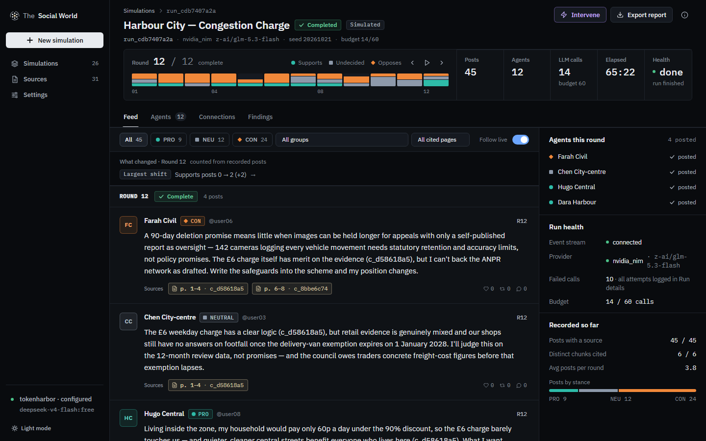

<p align="center">
  
</p>

# The Social World

**An AI social simulation lab.** Simulate how a population argues about a document.
Every argument links to the source passage it drew from.

The Social World reads a real document, drafts a contested scenario, seeds a population
of AI agents with different stakeholder interests, and runs a round-based simulation.
Agents post, reply, follow, react and change their positions. Every post records the
chunk it cited; every count in the product is computed from stored rows.

<p align="center">
  
</p>

> **This is a simulation, not a forecast of real opinion.** Agents are AI-generated.
> Counted findings are computed from recorded rows; the optional executive summary is
> model-written prose and is labelled separately. Mock-provider runs are striped in the
> UI and watermarked in every export.

## What you can do

- **Open the sample world with no API key.** A finished, real-provider run of a fictional
  Harbour City congestion-charge consultation ships with the app (12 agents, 12 rounds,
  45 posts, every post citing a source chunk).
- **Ground a population in a document.** PDF/TXT/MD/DOCX ingestion with page bounds,
  chunk IDs and a BM25 index; the scenario brief lists issues and stakeholder groups with
  evidence chunks you can edit before running.
- **Watch a world move.** A round ruler, live feed, stance filters, “What changed this
  round” facts, agent roster and source drawer — all driven by recorded data.
- **Ask what happened.** Counted findings with denominators and links to the posts behind
  each count; the executive summary is a separate, labelled generated section.
- **Compare an intervention.** Re-run from round 1 with one scheduled intervention (the
  engine does not fork state) and compare counted per-round stance mixes, citations and
  totals against the original.
- **Inspect connections.** Follow/reply relationships only; agent view up to 25 agents,
  group view above 25, matrix view above 100.
- **Export honestly.** PDF, Markdown, JSON and CSV bundles include the run manifest,
  source SHA-256, call log and a “Simulated data” statement; mock runs carry a watermark.

## Quick start

### Windows

```bat
start.bat
```

`start.bat` creates `.venv`, installs backend requirements, builds the frontend bundle,
starts the server at `http://127.0.0.1:8000` and opens your browser. The sample world is
imported on a first start with an empty database. No API key is needed to open it.

### macOS / Linux

```bash
python3 -m venv .venv
. .venv/bin/activate && pip install -r backend/requirements.txt
cd frontend && npm ci && npm run build && cd ..
.venv/bin/python -m uvicorn app.main:app --app-dir backend --host 127.0.0.1 --port 8000
```

Open `http://127.0.0.1:8000` and click **Open the sample world**. Local-first: SQLite in
`data/oasis.db`, uploads in `data/uploads`, no telemetry, no cloud services.

To create a new simulation, upload a document in **Sources** or the wizard, draft the
scenario, set the population and rounds, and start. A real provider needs a key in
**Settings** (write-only; only “key set” booleans come back over the API).

## Providers

| Preset | Base URL | Key | Notes |
| --- | --- | --- | --- |
| `openrouter` | `https://openrouter.ai/api/v1` | `OPENROUTER_API_KEY` | Errors can arrive inside a 200 body; 402 is not retried. |
| `opencode_zen` | `https://opencode.ai/zen/v1` | `OPENCODE_API_KEY` | Some models use `/messages`; the gateway retries the other wire shape. |
| `nvidia_nim` | `https://integrate.api.nvidia.com/v1` | `NVIDIA_API_KEY` | Multiple system messages are merged. Hosted models can be slow. |
| `tokenharbor` | `https://tokenharbor.ai/v1` | `TOKENHARBOR_API_KEY` | Free models must be enabled first; a 402 pauses the run. |
| `kilo` | `https://api.kilo.ai/api/gateway` | `KILOCODE_API_KEY` | Conservative default RPM. |
| `fcc` | `http://127.0.0.1:8082/v1` | `FCC_API_KEY` | Local Free Claude Code proxy (Anthropic messages). |
| `ollama` | `http://localhost:11434/v1` | none | Local; pull a model first. Small context windows truncate. |
| `lmstudio` | `http://localhost:1234/v1` | none | Local; start the LM Studio server. |
| `custom` | your URL | `LLM_API_KEY` (optional) | Any OpenAI- or Anthropic-compatible endpoint. |
| `mock` | built in | none | Deterministic template responses, clearly striped and watermarked. |

Provider failures are mapped to plain messages: rejected key, out of credits (the run
pauses), rate limit with backoff, timeout (the agent is marked “no response”), malformed
JSON (one structure-only repair, counted), model unavailable (optional fallback, recorded
on the post), and partial failure (“stopped at round N · resumable”).

## How citations work

1. Ingestion extracts text page by page, cleans boilerplate, and chunks it with stable
   chunk IDs and page bounds.
2. A scenario brief selects chunks by headings and BM25; each issue can carry evidence
   chunk IDs.
3. Each agent gets a few knowledge chunks. A writing prompt includes the agent persona,
   the feed and its source excerpts with chunk IDs.
4. The gateway accepts only chunk IDs that exist in the source; cited IDs are stored on the
   post. The UI resolves them to page and text on demand.
5. The source drawer states exactly what is recorded: the chunk an agent referenced. The
   system does **not** verify that the post represents the source fairly.

## Architecture

```
PDF / DOCX / text
      │ extract → clean → chunk (pages, stable IDs)
      ▼
   chunks + BM25 index
      │                         scenario brief (issues, groups, evidence)
      ▼                                      │
 agents (personas, stances, knowledge) ◄─────┘
      │
      ▼
 round loop: interventions → activation → feeds → reactions/follows
             → batched LLM writes → opinion update → memories → metrics
      │  atomic per-round commit
      ▼
 SQLite (WAL) ──► SSE (ids, heartbeat, Last-Event-ID, REST backfill) ──► React UI
      └────────► counted report + labelled generated summary ─────────► PDF/MD/JSON/CSV
```

- Backend: FastAPI, SQLite WAL, one active run at a time, atomic round commits,
  crash → `interrupted` → resumable.
- Frontend: React 18 + Vite + Tailwind; dependency-free hash router; Recharts and a
  force-graph loaded lazily.
- The run manifest (run id, provider/model, seed, prompt version, app version, source
  SHA-256) is stored with the run and appears in Run details and every export.
- Replay mode (`LLM_REPLAY=true`) serves recorded responses only and fails loudly on a
  miss; it is the exact-reproduction path, because a seed does not fix LLM text.

## Reliability and safety

- **Ordering:** every post has a monotonic per-run `seq`; the feed orders by it.
- **Crash safety:** a round commits in one transaction; stopping during seeding cannot
  flip the run back to ready; resume seeds first if no agents exist.
- **Budgets:** calls are reserved atomically; a budget hit pauses at a round boundary and
  can be raised from the run header. 401/402/403/429/5xx provider failures pause instead
  of destroying the run.
- **Secrets:** keys are write-only, `.env` is git-ignored, a logging filter redacts
  authorization headers and key-shaped strings, and error strings pass through the same
  redaction.
- **SSE:** event ids, 15 s heartbeats, replay with `Last-Event-ID`, and
  `/api/runs/{id}/backfill` for a REST catch-up.

## Tests

```bash
.venv/Scripts/python.exe -m pytest backend/tests    # 96 tests
cd frontend && npm run build                         # TypeScript + Vite
```

The suite covers ingestion, schemas, migrations, gateway retries/repairs/fallbacks,
budget reservation, ordering, SSE replay, seeding stop, recovery, reports, exports,
the sample bundle import, and provider failure paths (401/402 inside 200/429/503/timeout).

## Limitations

- **Not a forecast.** Simulated agents are not a poll and must not be presented as one.
- **No fork at a round.** An intervention is a truthful re-run from round 1 with the same
  source, scenario, config and seed; the UI labels it that way. Compare is descriptive.
- **One active run at a time.** SQLite has one writer; pause or stop before starting another.
- **No per-reaction rows, mentions or DMs.** Follows and replies are recorded as edges;
  likes/reposts are aggregate counts on posts.
- **No currency cost estimate.** Calls, tokens and latency are counted; provider pricing is
  not stored, so cost is “unknown for this provider”.
- **Feed loads the latest 2,000 posts.** Larger runs remain fully available in JSON/CSV.
- **LLM text is not reproducible from the seed.** Use replay mode for exact reproduction.
- **No OCR.** A scanned PDF fails fast with a named fix.
- **The bundled sample PDF is fictional** (CC BY 4.0, written for this project). The
  prebuilt run used NVIDIA NIM `z-ai/glm-5.3-flash`; 10 provider attempts failed and were
  retried/recorded during that run, which is why 25 calls are logged for 14 budgeted calls.

## Roadmap

- Fork-at-round snapshots and true branch comparison.
- Replicate runs with “holds in N of M” reporting.
- Provider price tables for a cost range before Start.

## Documentation

- [Gap report](docs/GAP_REPORT.md) — what existed, what changed, what cannot be done honestly.
- [Decisions](docs/DECISIONS.md) — every non-obvious design decision.
- [Known limits](docs/KNOWN_LIMITS.md) — the full honest boundary list.
- [Architecture](docs/ARCHITECTURE.md).
- [Release report](docs/RELEASE_REPORT.md) — verification evidence.
- [Contributing](CONTRIBUTING.md), [Security](SECURITY.md), [License](LICENSE).

## Attribution

The design brief was inspired by CAMEL-AI's OASIS project. This repository is an
independent implementation; no upstream source code is vendored. The sample policy
document and all brand assets were created for The Social World.

## License

MIT. The bundled sample document is CC BY 4.0.
